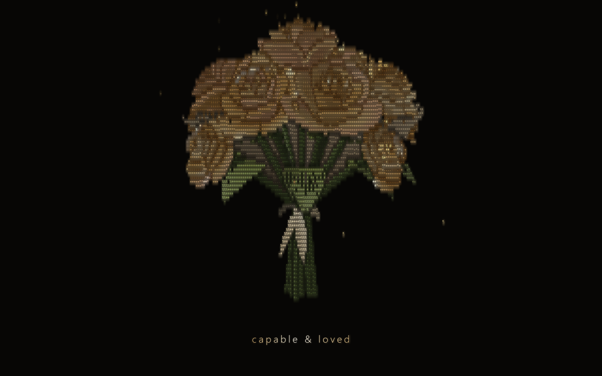

# bloom

A golden bouquet drawn with ASCII characters. Stems rise, the wrapping and the
satin bow appear, and roses open one after another until the whole bouquet is in
bloom and slowly shimmers in shades of champagne, honey and rose gold. Underneath,
a thin line of text appears: *capable & loved*.

Every frame comes from a real 3D model, rendered into a grid of characters.



## Features

- **A 3D bouquet.** A dome of roses, each with its own size, tilt, petal count and
  curl. The stems are gathered and tied with a satin bow, pearl paper wraps the back
  and leaves are tucked between the flowers.
- **Starlight gold.** The default palette is made to match a Starlight MacBook. The
  shadows fall into warm amber, the lit petals rise to champagne, and every rose
  starts at its own shade.
- **It grows.** Roses open one after another, outer petals first. Once open, each
  rose slowly breathes.
- **It is alive.** Golden pollen drifts up from the roses, petals now and then fall,
  and sparkles circle the bouquet. The bouquet sways gently from side to side.
- **The words.** A small line in a thin font with a gold glint running across it.
  Change it with `--message`.
- **Every seed arranges a different bouquet.** The same seed always gives the same one.

## Install

Requires Python 3.10+.

```bash
python -m venv .venv
# Windows
.venv\Scripts\activate
# macOS / Linux
source .venv/bin/activate

pip install -r requirements.txt
```

## Run

```bash
python -m bloom                       # full screen
python -m bloom --windowed            # in a window
python -m bloom --terminal            # right in the terminal
python -m bloom -m "for you"          # different words
python -m bloom moonlight -p sakura   # another bouquet, another palette
```

| Option | Description |
| --- | --- |
| `seed` | any word or phrase (default `starlight`) |
| `-p`, `--palette` | `starlight` (default), `rose`, `aurora`, `ember`, `ocean`, `sakura`, `prism` |
| `-m`, `--message` | words under the bouquet (default `capable & loved`, `""` for none) |
| `-w`, `--windowed` | open a window instead of full screen |
| `-t`, `--terminal` | render in the terminal |
| `--size` | window size in windowed mode (default `1280x800`) |
| `--font-size` | glyph size; smaller = more detail (default follows the screen height) |
| `--detail` | geometry density (default 0.6 in a window, 0.4 in the terminal) |
| `--speed` | animation speed multiplier |
| `--fps` | frame rate limit (default 60) |

### Controls

| Input | Action |
| --- | --- |
| drag | turn the bouquet |
| mouse wheel | zoom |
| click | gust of wind + a puff of pollen |
| `space` | grow the bouquet again |
| `n` | arrange a new random bouquet |
| `p` | next palette |
| `f`, `F11` | toggle full screen |
| `s` | save a screenshot to `screenshots/` |
| `h` | show / hide help |
| `esc`, `q` | quit |

### PyCharm

Shared run configurations live in `.run/` and appear in the run menu automatically:
`bloom` (full screen), `bloom (windowed)` and `bloom (terminal)`. They use the project
interpreter (`.venv`).

## How it works

1. **A rose** (`bloom/geometry.py`) is a parametric spiral surface: one parameter winds
   from the outer petals to the inner ones, the other runs from the base of a petal to
   its tip. The radius dips between neighbouring petals, which gives every petal its
   rounded edge. Each petal blends from a closed teardrop bud into its open shape.
2. **The bouquet** (`bloom/bouquet.py`) places roses on a dome, rotates each one to
   face outwards, runs the stems to a tie point, and adds the bow, the paper wrap and
   leaves. Roses that are fully open are cached and only re-transformed every frame.
3. **Rasterizing** (`bloom/raster.py`): points are projected with perspective onto the
   character grid, a z-buffer keeps the nearest point in every cell, and only those get
   lit (diffuse, specular glints, rim light, ambient occlusion). Where one petal
   overlaps another, the cell behind becomes a dark seam, so petals stay readable.
   Brightness picks the glyph from `.,:;-=+*#%@`.
4. **Drawing** (`bloom/draw.py`): glyphs are cached per character and color, and a soft
   glow in each cell's color goes underneath, so shapes read clearly from a distance.
5. **Lettering** (`bloom/lettering.py`): smooth text in a thin font, lit with the palette.
6. **Life** (`bloom/particles.py`): pollen, falling petals, sparkles.
